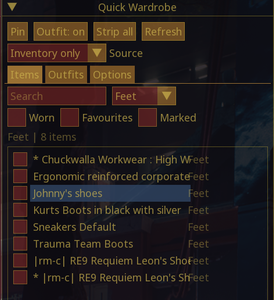

# Quick Wardrobe

A Cyber Engine Tweaks window that lists every Equipment-EX wardrobe item and puts it on or takes it off with one click, for Cyberpunk 2077. Single-player only.
Version 1.2.2 | For game version 2.5 | Status: 1.2.2 in use in my game and working; earlier versions were tried in game; no version has a written test record

> This is an unofficial fan work and is not approved/endorsed by CD PROJEKT RED. No game files are included.



The screenshot shows the window with the optional colour file described under "How it works".

## The problem

Equipment-EX lets you wear any clothing item as a look, but changing one piece means opening its wardrobe menu, finding the slot and scrolling to the item. Trying a few combinations, or swapping a jacket while walking around, takes many clicks and pauses the game each time.

## What I built

A CET window with every wardrobe item in one sorted list: click a row to put it on or take it off. The window can stay on screen after the CET overlay closes and be driven with hotkeys or with its own mouse cursor. It changes: what Equipment-EX shows as your outfit (through Equipment-EX's own functions), and, only when you press the stash button, where your marked clothing items are stored. 1,144 lines of Lua and a 776-line redscript bridge.

## How it works

- The redscript bridge talks to Equipment-EX only through its public API (`OutfitSystem`, `ViewManager`, `InventoryHelper`). No game function is wrapped or replaced, so every action is what Equipment-EX's own wardrobe screen would do.
- The list is built once, through one bridge call, and again only on a new save, a source change, Refresh, or an overlay open after the clothing count changed. Items with the same look (entity and appearance) are listed once, like Equipment-EX's grid.
- Filters: search, body area, worn only, favourites only, marked only. Favourites are kept in `favorites.json`. The source (wardrobe store, inventory plus stash, inventory only) is Equipment-EX's own setting and is shared with its menu.
- Outfits tab: Equipment-EX's saved outfits, click one to wear it, or save the current one under a new name (an existing name is refused, not overwritten). Buttons for outfit on / off and "Strip all" (two clicks).
- Stash: tick boxes mark items. "Move N marked to stash" sends every inventory copy of the marked looks to the stash, when a stash is in reach or you sit in your own car with a trunk. Worn items, quest items and items the game never lets into the stash stay. Marks are kept for the current game run only.
- Pin: the window stays on screen after the overlay closes and hides itself in menus and loading screens. Only the visible rows are drawn and every label is built with the list, so a pinned frame does no game calls. The outfit state is polled twice a second, only while the window is visible.
- Mouse mode: CET gives its windows the mouse only while the overlay is open, so the bridge reads the raw mouse through Codeware's input callbacks and the window draws its own cursor. While it has the mouse, the camera and weapons are held by the game's own gameplay restrictions; the keyboard stays free. A watchdog lets go of the mouse if the window stops asking for input for about 1.5 seconds, and every load clears the restrictions.
- The first lines of `init.lua` load an optional colour file, `cyberslop_palette.lua`, if it sits next to it. It is not part of this repository; without it the window uses CET's default colours.

```text
package/
  bin/x64/plugins/cyber_engine_tweaks/mods/CyberslopQuickWardrobe/init.lua   the window
  r6/scripts/CyberslopQuickWardrobe/CyberslopQuickWardrobe.reds              bridge to Equipment-EX
```

## Requirements

| Requirement | Version | Link |
|---|---|---|
| Cyberpunk 2077 | 2.5 | |
| Cyber Engine Tweaks | a build for 2.5 | [Nexus Mods, mod 107](https://www.nexusmods.com/cyberpunk2077/mods/107) |
| redscript | a build for 2.5 | [Nexus Mods, mod 1511](https://www.nexusmods.com/cyberpunk2077/mods/1511) |
| Codeware | a build for 2.5 | [Nexus Mods, mod 7780](https://www.nexusmods.com/cyberpunk2077/mods/7780) |
| Equipment-EX (by psiberx) | built against 1.3.1 | [Nexus Mods, mod 6945](https://www.nexusmods.com/cyberpunk2077/mods/6945) |

The redscript file imports Equipment-EX and does not compile without it. Codeware provides the mouse input for mouse mode. Requirements are not bundled.

## Install

1. Install the requirements above.
2. Copy the contents of `package/` into the game folder, so that `bin\x64\plugins\cyber_engine_tweaks\mods\CyberslopQuickWardrobe\init.lua` exists.
3. Start the game, load a save and open the CET overlay. The "Quick Wardrobe" window lists the items of the source Equipment-EX uses.

## Uninstall / roll back

1. If mouse mode is on, give the mouse back (Done, or a click outside the window) and make a new save. The camera restriction that mouse mode uses is stored in saves; without the mod, nothing removes it from a save made in mouse mode (not tested).
2. Close the game.
3. Delete `bin\x64\plugins\cyber_engine_tweaks\mods\CyberslopQuickWardrobe\` (this also removes `config.json`, `favorites.json` and, if it exists, `CyberslopQuickWardrobe.log`) and `r6\scripts\CyberslopQuickWardrobe\`.
4. The mod keeps one flag in the save (whether mouse mode was holding the camera). Saves load without the mod. What you wear is Equipment-EX's outfit and stays with Equipment-EX. Items moved to the stash stay in the stash.

## Configuration

Options tab, saved in `config.json` next to `init.lua`:

| Option | Default | Range |
|---|---|---|
| Pinned opacity | 0.6 | 0.1 to 1.0 |
| Pinned: take the mouse when the overlay closes | on | |
| Mouse speed | 1.0 | 0.2 to 4.0 |

The window also remembers Pin, the body area and the Worn, Favourites and Marked filters. Settings are written when one of these changes in the window, when the overlay closes, on Pin and when the game quits; the body-area hotkeys do not write the file.

Hotkeys in CET's Bindings tab, all unbound by default:

| Binding | What it does |
|---|---|
| Quick Wardrobe: pin / unpin the window | same as the Pin button |
| Quick Wardrobe: mouse mode on / off (pinned window) | the pinned window takes or releases the mouse |
| Quick Wardrobe: cursor down / cursor up (hold to scroll) | moves the cursor row of the pinned window |
| Quick Wardrobe: put on / take off the item under the cursor | |
| Quick Wardrobe: mark / unmark the item under the cursor (for the stash) | |
| Quick Wardrobe: move the marked items to the stash | only while the window is on screen |
| Quick Wardrobe: next body area / previous body area | |
| Quick Wardrobe: outfit on / off | works without Pin too |
| Quick Wardrobe: wear the next saved outfit | works without Pin too |

## Status

| Version | Game | Result |
|---|---|---|
| 1.0.0 | 2.5 | Compiles (0 errors). Tried in game: version 1.1.0 was built on requests made after a 1.0.0 test. No written test result. |
| 1.1.0 | 2.5 | Compiles (0 errors). No in-game record. |
| 1.2.0 | 2.5 | Compiles (0 errors). A first build was tried in game; it was changed after a report that no cursor showed with Pin off. No written test result. |
| 1.2.1 | 2.5 | Compiles (0 errors). No written test record. |
| 1.2.2 | 2.5 | Compiles (0 errors). In use in the author's game and working (author's statement, 2026-11-24). No written test record. |

"Compiles" means an offline redscript compile against the full installed script set, with no new warnings. The offline mock test used during development is not part of this repository.

## Compatibility

| Item | Status | Notes |
|---|---|---|
| Equipment-EX 1.3.1 | required | Only its public API is used. Other Equipment-EX versions were not checked. |
| Equipment-EX's wardrobe menu | shares settings | The item source and saved outfits are Equipment-EX's own. |
| Other CET windows | not affected | The window touches no other CET window. |

## Known issues

- The version shown in the Options tab reads 1.2.0; the files are 1.2.2. The string was not updated.
- If the camera ever stays held, load a save or reload CET mods: every load clears the restrictions and the watchdog lets go within about 1.5 seconds.

## Engineering notes

**A save made in mouse mode (1.2.1).** Mouse mode holds the camera with the game's own `NoCameraControl` restriction. A review of 1.2.0 found that this restriction is saved with the game, while the weapon restriction is not. A save made while the window had the mouse could therefore load with the camera still held, if the cleanup on load ran before the saved effect was restored. Fix: one saved flag records that mouse mode was on, and 1.5 seconds after every load a second cleanup removes the restriction again, by this mod's instigator and, when the flag is set, by its record ID. This was found by review, not seen in play.

**An empty list kept for good (1.2.2).** When the window asked for the list before Equipment-EX or the player was ready, the bridge returned an empty list, and the window treated it as built. Now the bridge returns -1 in that case and the window asks again by itself.

**Design choices visible in the code.** No hooks: everything goes through Equipment-EX's API, so the mod cannot disagree with Equipment-EX about what is worn. Building the list is the one heavy call, so it never runs during play; while pinned, the window only checks the store count every 10 seconds and shows "new items: open the overlay". Marks are never saved, so an old mark cannot send clothes to the stash later.

**Rollback.** Each version was installed with a backup of the previous files. For a user: delete two folders.

## Changelog

See [CHANGELOG.md](CHANGELOG.md). Latest: 1.2.2 (2026-11-23): the list is fetched again by itself when Equipment-EX was not ready yet.

## Credits and licence

Runs on Cyber Engine Tweaks, redscript, Codeware and Equipment-EX by psiberx, which are not included here. The way mouse mode holds the camera and weapons follows the "Mouse only" method of the Overlay Map mod.

MIT, see [LICENSE](LICENSE). The licence covers my code only. Game names and trademarks belong to their owners.

Built with AI assistance (Claude); designed, tested and maintained by me.
